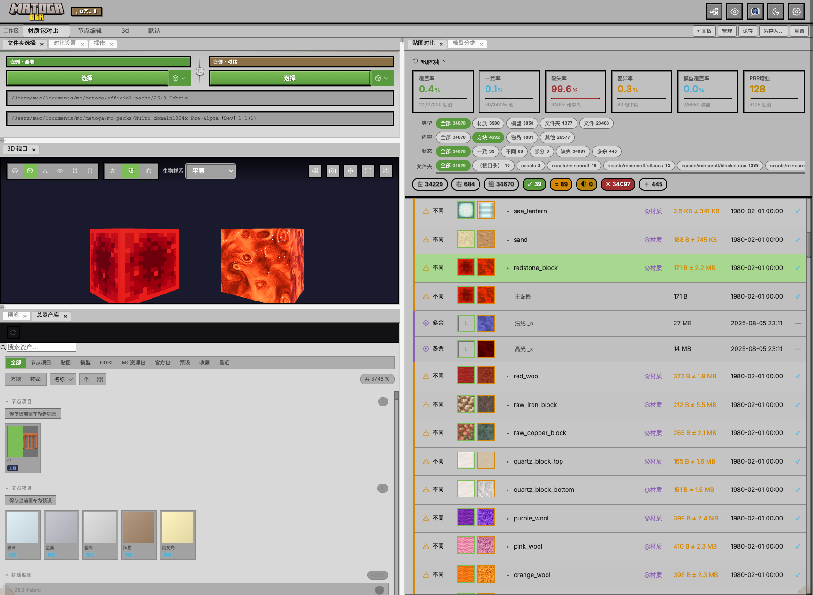
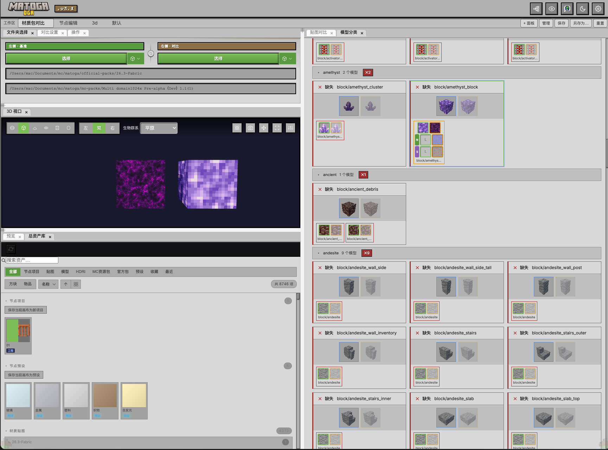

<div align="center">

# matoga · 材质贴图对比工具

**对比两个文件夹中的材质贴图，3D 实时预览 · 节点材质编辑 · Blockbench 集成**

`v3.2.0` · Node.js ≥ 18 · MIT License

[功能](#-功能特性) · [快速开始](#-快速开始) · [使用方式](#-使用方式) · [版本管理](#-版本管理) · [目录结构](#-目录结构) · [技术栈](#-技术栈) · [渲染架构](#-渲染架构) · [参考项目](#-参考项目与资料)

</div>

---

## 📌 项目简介

matoga 是一个基于 **Node.js + Express + Three.js** 的本地 Web 服务应用（B/S 架构），专为 **Minecraft 材质包开发**工作流设计。浏览器访问 `localhost:5273` 即可使用，无需安装前端框架，无需构建步骤。

🌐 **官网**：<https://zhishioga.innovaage.cn/>

**核心能力**：文件夹对比 → 差异识别 → 2D/3D 预览 → 节点材质编辑 → Blockbench 建模 → 资产库管理，全流程闭环。

---

## 📸 界面预览





---

## 🎨 渲染架构

matoga 的"渲染"是**多技术栈并存的复合管线**，按场景分为 6 个子系统，协同完成从像素处理到 3D 实时绘制的全流程。

| 子系统 | 技术 | 用途 | 核心文件 |
|--------|------|------|---------|
| **A. 3D 材质预览** | Three.js WebGL | PBR 材质球 / MC 模型视口实时渲染 | `web/src/material3d.js`、`mc-model-viewer.js` |
| **B. 2D 贴图对比** | Canvas 2D + DOM/CSS | 通道提取、tint 染色、分屏滑块、像素差异 / 热力图 / 直方图 | `web/src/preview2d.js`、`actions.js` |
| **C. 对比列表渲染** | 纯 DOM/CSS | 文件夹对比结果表格、统计卡片、侧边栏 | `web/src/render.js` |
| **D. UV 贴图编辑器** | Canvas 2D | 模型贴图大图 + UV 采样矩形叠加 + 编辑手柄 | `web/src/uv-editor-core.js` |
| **E. 节点材质编辑器** | SVG + DOM + Canvas 2D + Three.js | 节点图拓扑求值与多目标预览联动 | `web/src/node-canvas.js`、`node-preview.js`、`node-canvas/noise.js` |
| **F. 模型缩略图离屏渲染** | Three.js WebGL（离屏） | 资产库模型卡片 3D 缩略图 | `web/src/model-thumb.js` |

### 关键渲染特性

- **PBR + 视差遮挡映射（POM）**：通过 `MeshPhysicalMaterial.onBeforeCompile` 注入 GLSL，实现简单偏移 / Steep Parallax / 二分查找 / 视差自阴影四种模式（`material3d.js` makeMaterial）
- **通道提取管线**：Canvas 2D `getImageData` 逐像素处理 → `CanvasTexture` 喂给 Three.js（粗糙度 R 反相、金属度 G、自发光 A 掩膜、法线 XY→XYZ 重建、法线积分推算高度图）
- **节点图驱动 3D**：节点编辑器 Kahn 拓扑排序求值 → `applyNodePBRSide` 实时驱动左右 3D 材质球
- **离屏缩略图管线**：单个共享离屏 `WebGLRenderer` 串行排队，按包围球自动定距，透明背景 PNG 输出
- **无构建直跑**：全部原生 ES Modules，浏览器直接 `import` 加载

### 渲染流程概要

```
文件夹对比  loadFolder → scanFiles → compare → renderResult + renderSidebar
                                                              ↓
3D 材质预览  updateMaterial3D → applyTexturesToMesh（通道提取 + POM 注入）
                              → animate() RAF → renderer.render()
                                                              ↓
节点编辑    evaluate()（拓扑排序）→ syncToPreview → applyNodePBRSide → 3D 联动
                                                              ↓
2D 对比     showPixelDiff（diff / heat / channel / hist 四模式）
```

---

## ✨ 功能特性

### 1. 文件夹对比
- 选择左右两个文件夹，按名称对比内容，支持递归子目录
- **MD5 哈希校验**识别内容差异
- 忽略规则（系统文件 + 自定义通配符）
- 五种状态分类：

  | 标记 | 含义 |
  |:----:|------|
  | ✓ | 一致 |
  | ≈ | 内容不同 |
  | ◐ | 部分缺失 |
  | ✗ | 右侧缺失 |
  | ＋ | 右侧多余 |

- 搜索（⌘K）、状态过滤、多字段排序、大小分布直方图
- **2D 像素差异对比**：差异图 / 热力图 / 通道 / 直方图四种模式

### 2. 材质贴图识别
按后缀自动分组，三种角色：

| 后缀 | 角色 | 说明 |
|------|------|------|
| 无后缀 | 主贴图（diffuse） | 基础色 / 漫反射 |
| `_n` | 法线贴图 | RGB 为法线方向，A 通道为法线强度 / 高度图 |
| `_s` | 高光贴图 | R=粗糙度，G=金属度，B=自发光，A=自发光掩膜（LabPBR） |

### 3. 3D 材质预览（Three.js）
- **几何体**：球体、立方体、平面、圆环、圆柱、胶囊
- **PBR 参数**：金属度、粗糙度、法线强度、自发光强度
- **视差遮挡映射（POM）**：从法线贴图 alpha 通道提取高度图，或从法线 RGB 推算
- 法线重建：用 alpha 通道作为法线强度系数
- 高光贴图格式自动检测（旧版 / LabPBR）
- 通道提取：粗糙度（R 反相）、金属度（G）、自发光（A 掩膜）
- **HDR 环境贴图**加载（.hdr / .exr）
- **大气散射天空**（turbidity / rayleigh / mie 等参数可调）
- 五种光照预设：工作室、户外阳光、柔和均匀、暖光、冷光
- 透明度模式：cutout（Alpha Test）/ blend（半透明）/ glass（玻璃透射）
- 交互：鼠标拖拽旋转、滚轮缩放、双击切换自动旋转
- 截图导出、全屏模式

### 4. 动态面板工作区（v3.0+）
- Adobe 风格浮动面板系统，基于 **Golden-Layout**（DOM 迁移法）
- **11 个 manifest 驱动**的可组合面板：文件夹卡片、对比设置、操作、对比列表、预览、详情、3D 材质、节点画布、节点库、资产库、Blockbench
- 工作区预设：多布局保存 / 切换 / 重命名 / 激活
- 可拖拽浮动窗口，几何位置本地记忆

### 5. 节点材质编辑器
- 可视化节点画布（独立 iframe 页面），JS 节点引擎
- 节点库、节点关系浮窗、节点预览浮窗
- `.mtgp` 自包含工程格式（project.json + 缩略图 + 贴图），支持保存 / 加载 / 管理

### 6. Blockbench 集成
- 自托管 Blockbench Web 产物（`npm run bb:fetch` 拉取，缺失时显示占位页）
- **matoga-bridge** 桥接插件：发送模型到 matoga / 拉取 matoga 材质，postMessage 实时同步
- 模型与材质收件箱管理（服务端持久化）

### 7. MC 模型预览
- Minecraft `.json` 模型渲染（parent 继承链解析）
- Blockbench `.bbmodel` 渲染
- UV 贴图布局视图（浮动窗口）

### 8. 资产库与材质包管理
- **总资产库**：聚合贴图 / 模型 / HDRI / MC 材质包 / 官方包 / 节点预设，收藏夹与最近使用服务端持久化
- **MC 官方材质包**：pack.mcmeta 版本分析（pack_format → MC 版本映射）、包内浏览、重命名
- 用户 MC 资源包「包媒体」库（路径可配置）
- 服务端贴图 / HDRI 缩略图生成，前端懒加载 + Blurhash + HDR 预览 Worker

### 9. 文件操作
- 复制 / 备份 / 删除文件
- 批量同步到左 / 右侧（WebSocket 实时进度 + 可取消）
- 撤销操作、在系统文件管理器中打开

### 10. 其他
- 对比结果导出（HTML）
- 深色 / 浅色主题切换、中 / 英文界面切换
- 配置持久化（4 项资源路径可配置：HDRI 预设 / MC 材质包 / 玩家材质包 / MC 官方材质包）
- 健康检查 API（`GET /api/health`：uptime / 内存 / Node 版本）

---

## 🚀 快速开始

### 环境要求
- **Node.js ≥ 18**（推荐 20+）
- npm 9+

### 安装与启动
```bash
# 1. 克隆仓库
git clone https://github.com/xiongmiaozai/matoga.git
cd matoga

# 2. 安装依赖
npm install

# 3. 启动本地 Web 服务（默认 127.0.0.1:5273，端口占用时自动递增重试）
npm start
```

启动后在浏览器打开 **http://localhost:5273/** 即可使用。

---

## 📖 使用方式

### 基本工作流
```
选择左右文件夹 → 点击「对比」 → 查看差异列表 → 2D/3D 预览 → 调整材质 → 同步缺失文件
```

### 详细步骤
1. 启动服务后在浏览器打开 `http://localhost:5273/`
2. 点击**左侧 / 右侧文件夹卡片**，分别选择要对比的两个文件夹
3. 点击「对比」按钮，生成差异列表
4. 点击列表项查看 **2D / 3D 预览**
5. 在 3D 预览面板可调整材质参数、光照、几何体，并加载 HDR 环境贴图
6. 可对缺失文件执行复制 / 批量同步操作（批量复制时显示实时进度，可取消）
7. 顶栏可打开**节点关系 / 节点预览 / Blockbench** 浮动窗口，进入节点材质编辑与方块建模工作流

### 运行模式

| 命令 | 说明 |
|------|------|
| `npm start` | 本地 Web 服务（默认 127.0.0.1:5273） |
| `npm start -- --port 8080` | 自定义端口 |
| `npm run web:lan` | 局域网模式（0.0.0.0 + token 鉴权） |
| `npm run electron` | 桌面版（Electron 壳复用本地服务） |
| `npm run electron:dev` | 桌面版开发模式 |

> ℹ️ Blockbench 集成需自托管 Web 产物，详见 [Blockbench 集成](#6-blockbench-集成)章节说明。

### 打包发布

**独立可执行文件（pkg，免安装，运行后自动打开浏览器）**
```bash
npm run build:win      # Windows x64
npm run build:mac      # macOS arm64
npm run build:linux    # Linux x64
```

**桌面安装包（electron-builder：NSIS / DMG / AppImage + deb）**
```bash
npm run dist:win
npm run dist:mac
npm run dist:linux
```

### 开发与测试

| 命令 | 说明 |
|------|------|
| `npm test` | 运行单元测试（node:test） |
| `npm run test:smoke` | 冒烟 + WebSocket 集成测试 |
| `npm run lint` | ESLint 代码检查 |
| `npm run lint:fix` | ESLint 自动修复 |
| `npm run format` | Prettier 格式化 |
| `npm run format:check` | Prettier 格式检查 |

### 环境变量

| 变量 | 说明 | 默认值 |
|------|------|--------|
| `MATOGA_DATA_ROOT` | 运行时数据目录 | `data/` |
| `MATOGA_PRESET_ROOT` | 资源预设根目录 | - |

---

## 🗂️ 版本管理

### 当前版本
**v3.2.0**（见 `package.json`）

### 版本演进概览

| 版本 | 阶段 | 主要特性 |
|------|------|---------|
| **3.2.0** | 当前 | 主题编辑器面板、快捷键映射系统、CI 流水线、项目治理文档化、冒烟测试重构 |
| **3.1.1** | 安全修复 | 路径遍历、正则注入、HTTP 状态码、前端闭包/Promise 修复 |
| **3.1.0** | 资产库 | 资产库增强、性能优化、稳定性修复 |
| **3.0.x** | 动态面板 | Golden-Layout 浮动面板系统、11 个 manifest 驱动面板、工作区预设 |
| **2.x.x** | 3D 预览成熟 | PBR 材质、POM 视差遮挡、HDR 环境、大气散射天空 |
| **1.x.x** | 基础对比 | 文件夹对比、MD5 校验、2D 差异、基础 3D 预览 |

### 版本号规则
采用 **语义化版本**（Semantic Versioning）`MAJOR.MINOR.PATCH`：
- **MAJOR**：不兼容的 API 变更
- **MINOR**：向下兼容的功能新增
- **PATCH**：向下兼容的问题修复

### 升级方式
```bash
# 拉取最新代码并更新依赖
git pull && npm install

# 或重新克隆
git clone https://github.com/xiongmiaozai/matoga.git
```

### 配置与数据迁移
- 用户配置、工作区、资产库、节点工程均存储于 `data/` 目录（或 `MATOGA_DATA_ROOT` 指定路径）
- 升级时 `data/` 目录保留，无需手动迁移
- 如遇配置不兼容，删除 `data/` 对应子目录即可重置

---

## 📁 目录结构

```
matoga/
├── server/                # 后端服务
│   ├── index.js           # 入口（CLI 参数解析、启动 HTTP + WS 服务）
│   ├── app.js             # Express 应用（路由挂载、静态资源）
│   ├── ws.js              # WebSocket 服务（批量复制进度）
│   ├── paths.js           # 资源根 / 数据根路径解析
│   ├── shutdown.js        # 优雅停机
│   ├── config/            # 配置存储（原子读写）
│   ├── middleware/        # 中间件（日志、错误、鉴权、校验）
│   ├── services/          # 业务服务（scan、file、sync、hdri、thumb 等）
│   └── routes/            # REST 路由（fs、compare、file、hdri、config 等）
├── shared/                # 共享错误定义
├── web/                   # 前端（浏览器端，静态资源根）
│   ├── index.html         # 主界面
│   ├── node-editor.html   # 节点画布（独立 iframe 页面）
│   ├── renderer.js        # 渲染入口
│   ├── styles.css         # 主样式
│   ├── mc-theme.css       # Minecraft 主题样式
│   ├── blockbench-plugins/# Blockbench 桥接插件（matoga-bridge）
│   ├── assets/            # 静态资源（svg 图标、logo、字体、mc-icons）
│   ├── api/               # API 适配层（api-client.js + folder-tree.js）
│   └── src/               # 业务逻辑（对比、渲染、3D 预览、面板系统等）
│       └── panels/        # manifest 驱动的动态面板（11 个）
├── test/                  # 测试
│   ├── unit/              # 单元测试（node:test）
│   └── smoke/             # 冒烟 + WebSocket 集成测试
├── docs/                  # 设计与算法文档
│   ├── parallax-mapping.md          # 视差贴图
│   ├── parallax-mapping-mastery.md  # 视差贴图进阶
│   ├── normal-gen-node.md           # 法线生成节点
│   ├── 纹理过滤技术.md              # 纹理过滤
│   ├── 界面设计方案.md              # 界面方案
│   └── 优化方案.md                  # 优化方案
├── electron/              # 桌面版（Electron 壳）
├── archive/electron/      # 旧版 Electron 归档
├── scripts/               # 脚本（fetch-blockbench.mjs 等）
├── data/                  # 运行时数据（缩略图、工作区、资产库等）
├── hdri-presets/          # HDR 环境贴图预设
├── mc-packs/              # 用户 MC 材质包目录（路径可配置）
├── official-packs/        # MC 官方材质包目录
├── website/               # GitHub Pages 官网（独立）
├── dist/                  # 打包产物输出目录
└── package.json
```

---

## 🛠️ 技术栈

| 层 | 技术 | 用途 |
|----|------|------|
| **后端** | Node.js@≥18 + Express 5 | 本地 HTTP 服务端（REST API + 静态资源） |
| **实时通信** | WebSocket (ws 8) | 批量复制实时进度推送与取消 |
| **3D 渲染** | Three.js 0.186 | 3D 渲染与 PBR 材质 |
| **面板布局** | Golden-Layout 2.6 | 浮动面板布局系统 |
| **前端** | 原生 JavaScript（ES Modules） | 无构建工具、无前端框架 |
| **桌面壳** | Electron | 桌面版复用本地服务 |
| **打包** | @yao-pkg/pkg | 免安装可执行文件 |
| **安装包** | electron-builder | NSIS / DMG / AppImage + deb |
| **代码质量** | ESLint 9 + Prettier 3 | 代码检查与格式化 |
| **测试** | node:test | 单元测试 + 冒烟集成测试 |

---

## 📚 相关文档

- [`docs/parallax-mapping.md`](docs/parallax-mapping.md) — 视差贴图原理
- [`docs/parallax-mapping-mastery.md`](docs/parallax-mapping-mastery.md) — 视差贴图进阶
- [`docs/normal-gen-node.md`](docs/normal-gen-node.md) — 法线生成节点
- [`docs/纹理过滤技术.md`](docs/纹理过滤技术.md) — 纹理过滤技术
- [`docs/界面设计方案.md`](docs/界面设计方案.md) — 界面设计方案

---

## 🔗 参考项目与资料

matoga 的渲染管线借鉴并整合了以下开源项目与公开资料的思想，在此致谢。

### 同类 / 借鉴项目

| 项目 | 相似点 | 用途参考 |
|------|--------|---------|
| [Blockbench](https://github.com/JannisX11/blockbench) | Three.js + `MeshPhysicalMaterial` + `onBeforeCompile` 着色器注入；`.bbmodel` / MC `.json` 模型构建；UV 编辑；mcmeta 动画贴图 | 模型查看、UV 编辑、桥接集成 |
| [LabPBR-Viewer](https://github.com/labPBR/LabPBR-Viewer) / Continuum PBR Viewer | LabPBR 规格通道提取（R→粗糙度, G→金属度, A→自发光） | PBR 通道提取逻辑（`material3d.js`） |
| [Material Maker](https://github.com/RodZill-4/material-maker) | 节点图拓扑求值 + 噪波节点 + PS 混合模式 + 实时预览 | 节点材质编辑器（`node-canvas.js`） |
| [pixelmatch](https://github.com/mapbox/pixelmatch) | 逐像素差异比较 | 像素差异 / 直方图（`actions.js` showPixelDiff） |
| [three.js Sky shader](https://threejs.org/examples/?q=sky) | 大气散射天空（turbidity / rayleigh / mie） | 环境光照预设 |
| [PMREMGenerator](https://threejs.org/docs/#api/en/extras/PMREMGenerator) | HDR 环境贴图预滤波 | IBL 环境光照 |

### 学习资料

- [LearnOpenGL Parallax Mapping](https://learnopengl.com/Advanced-Lighting/Parallax-Mapping) — 视差映射原理（Steep Parallax、二分查找）
- [LabPBR Specification](https://github.com/labPBR/LabPBR-Specification) — LabPBR 材质规格（`_s` 贴图通道定义）
- [Minecraft Wiki · Resource pack](https://minecraft.wiki/w/Resource_pack) — MC 材质包格式、`pack.mcmeta`、mcmeta 动画
- [Minecraft Wiki · Model](https://minecraft.wiki/w/Model) — MC 模型 JSON 格式（parent 继承、elements、UV 0-16 像素映射）
- [Adobe Photoshop Blending Modes](https://helpx.adobe.com/photoshop/using/blending-modes.html) — PS 27 种混合模式数学定义
- [IQ · Color Palettes](https://iquilezles.org/articles/palettes/) — iq 余弦调色板（节点 `palette`）

> matoga 的独特之处在于将「双文件夹对比 + PBR 材质球预览 + MC 模型查看 + UV 编辑 + 节点材质编辑」五条渲染管线整合到一个无构建的 Web 应用里，目前尚无完全相同的开源项目。

---

## 👤 作者

**芝世 (xiongmiaozai)** — 2720596091@qq.com

## 📄 许可证

[MIT License](LICENSE) — Copyright (c) 2026 芝世 (xiongmiaozai)

## 📢 使用声明

他人使用本项目时，需保留并标明以下信息：
- **作者**：芝世 (xiongmiaozai)
- **来源地址**：https://github.com/xiongmiaozai/matoga